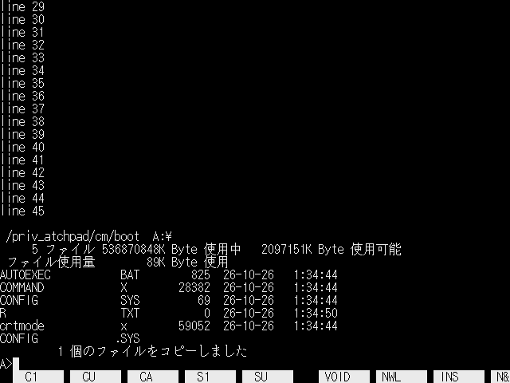
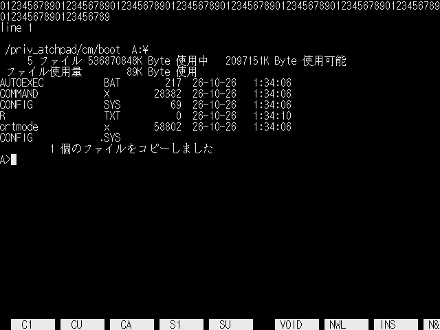
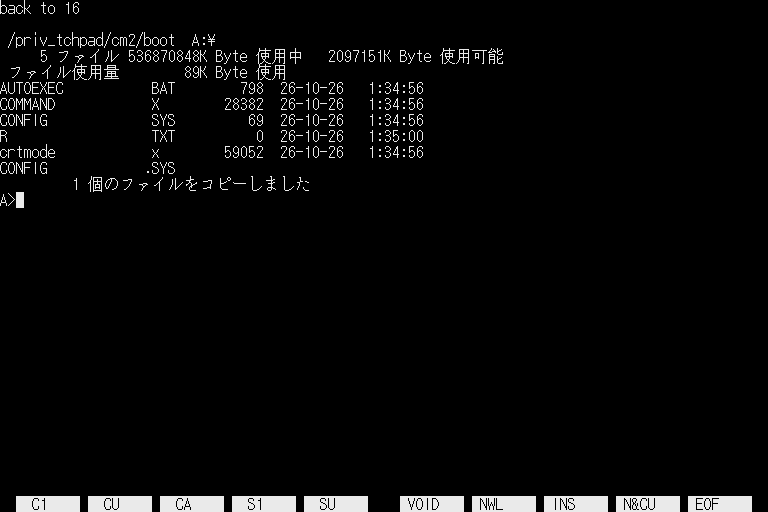

# crtmode.x -- 画面モードを変える

Human68k の文字の画面を、指定した画面モード (IOCS `_CRTMOD`) にする小さなコマンド。

```
crtmode 19     640x480 (31kHz) にする。80 桁 x 29 行 + ファンクションキー行
crtmode 16     768x512 (31kHz) に戻す。96 桁 x 31 行 + ファンクションキー行
crtmode -f N   _CRTMOD の結果を確かめずにコンソールを設定する
```

三菱 MDT243WG のように、31kHz の信号を 640x480 と見なして、モード 16 の上か下を切ってしまうモニター向け。`AUTOEXEC.BAT` から `crtmode 19` を呼ぶ。モードは 0 から 19。

## 何をするか

`_CRTMOD` はコンソールの範囲を全画面に戻して画面を消す。そのあとで次をする。

1. ファンクションキー行を元の表示モードで描き直す。Human68k はこの行を、画面の高さにかかわらず 31 行目 (ラスタ 496 から 511) に描く。480 行以下のモードでは画面の外になるので、テキスト VRAM のその行を画面の最下行 (29 行目) に写す。幅が 80 桁なので、右端の F10 の表示は半分で切れる
2. コンソールの範囲 (`_B_CONSOL`) を、桁数 = 幅 / 8、行数 = 高さ / 16 - 1 (ファンクションキー行の分) にする
3. 画面を消して、カーソルを左上に置く

`_CRTMOD` を呼んでも現在のモードが変わらない機種 (XEiJ の SUPER など古い ROM は、モード 19 を黙って無視する) では、メッセージを出して何もせず終わる。`-f` を付けるとそのまま続ける。

## 試験

`tests/xeij_crtmode.sh` が XEiJ を起動し、`crtmode 19` のあとに 100 桁の行、スクロール、`DIR` を流して画面を PNG にする。`RESTORE=1` で `crtmode 16` に戻す場合も撮る。`MODEL=Hybrid` (IPLROM 1.6) で確かめた。80 桁で折り返し、スクロールしても最下行のファンクションキー行と重ならない。

  
