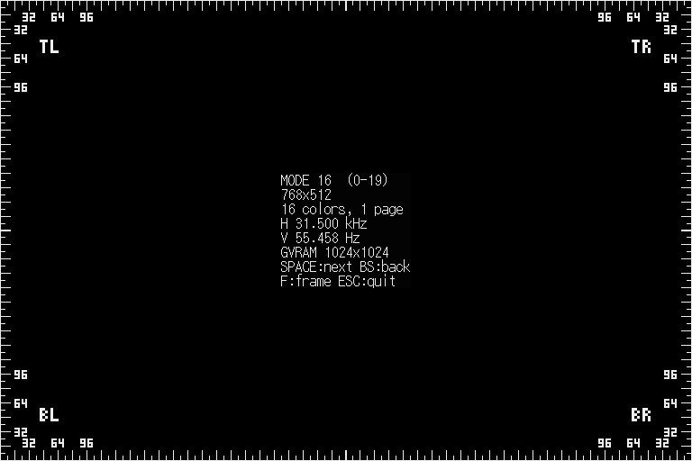
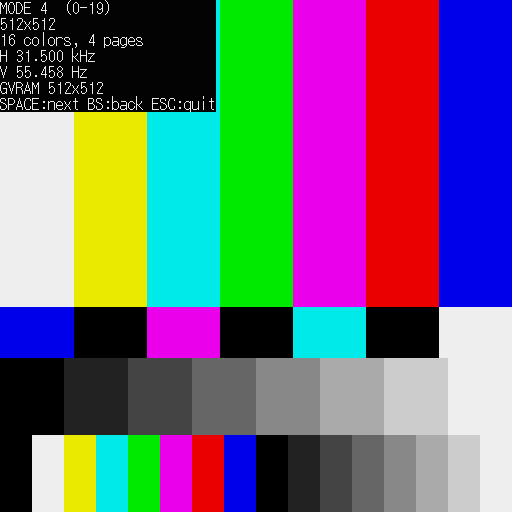
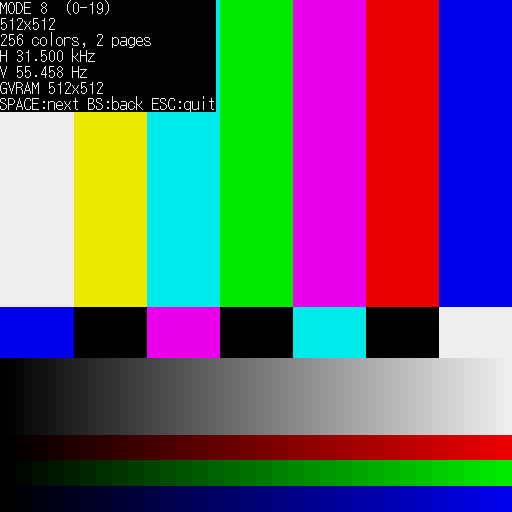
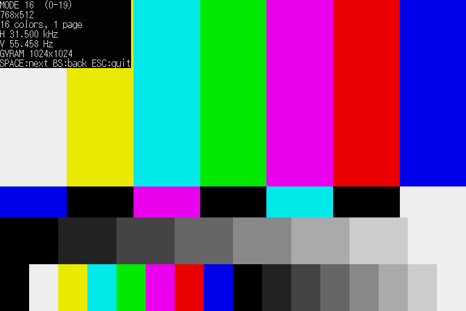
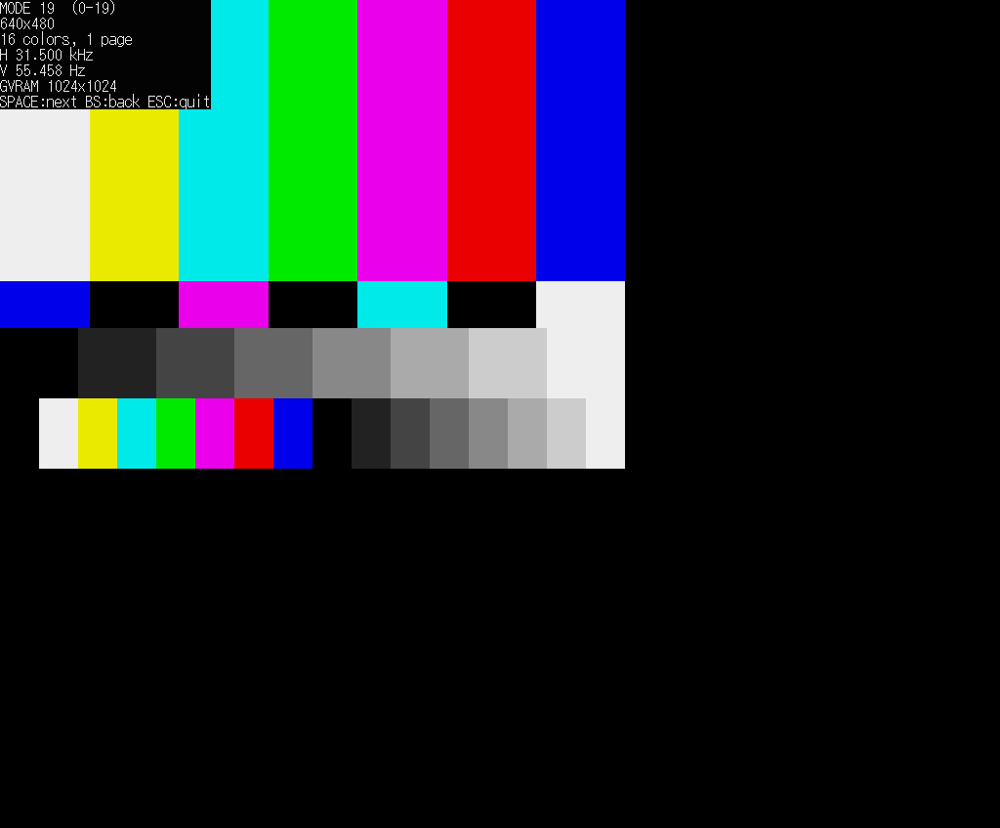
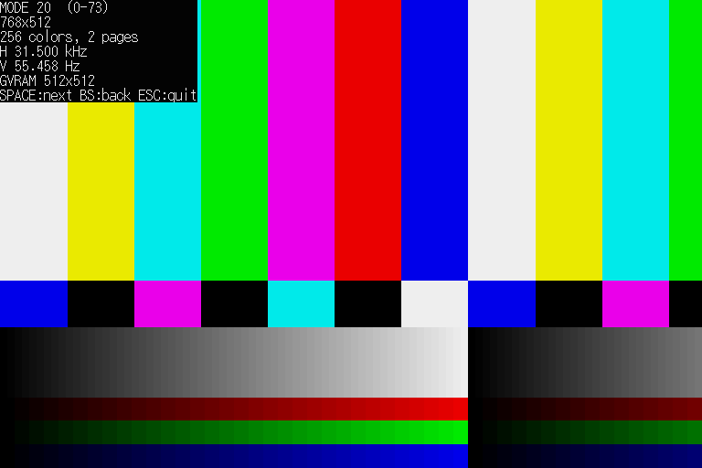
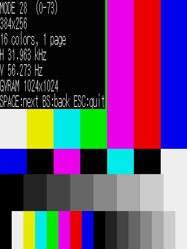
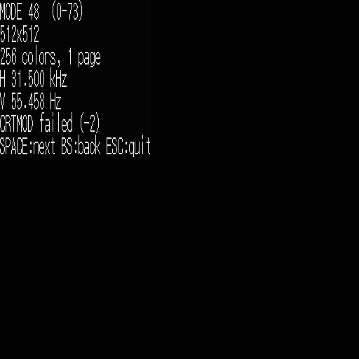
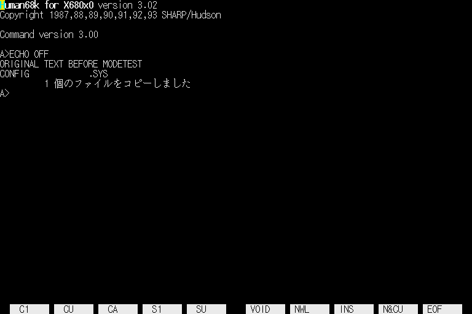

# modetest.x -- 画面モードの試験表示

X68000 / X68000 Z の画面モード (IOCS `_CRTMOD`) を 1 つずつ切り替え、モードごとにカラーバーを描くプログラム。
モニターが 15kHz / 24kHz / 31kHz のどれに対応しているか、キャプチャボードがどのモードを映せるかを確かめるために作った。

## 使い方

```
modetest [-x] [-l] [モード番号]
```

| キー | 動作 |
|---|---|
| SPACE / Enter / → / ↓ / そのほかのキー | 次のモード |
| BS / ← / ↑ / P | 前のモード |
| F | 枠だけの画面 (カラーバー無し) と通常の画面を切り替える |
| ESC / Q | 終了。元のモードとテキスト画面に戻す |

- XVI では `c:modetest`、Z では `b:modetest` で動かす。
- 画面が映らないモード (モニターが対応していない周波数) でも、キーは受け付ける。映らなかったら SPACE か BS で進む。
- 引数に数字を渡すと、そのモードから始める。
- `-l` は画面に触らず、モードの一覧 (大きさ・色数・周波数) を標準出力に出す。
- `-x` は番号 20 以降の拡張モードも回る (後述)。

## 画面の内容

テキスト画面の中央に、次の 6 行を黒地に白で出す。モードの番号、見える大きさ、色数とページ数、水平同期、垂直同期、GVRAM (グラフィック VRAM) の実際の大きさ。その下のグラフィック画面に、上から次の段を描く。

1. 7 色のカラーバー (白 黄 シアン 緑 マゼンタ 赤 青)。画面の 60%
2. 青 黒 マゼンタ 黒 シアン 黒 白 の細い段 (10%)
3. 灰色の階段 (15%)。16 色モードは 8 段、256 色と 65536 色のモードは 64 段
4. 最下段 (15%)。16 色モードはパレット 16 色を 1 本ずつ。256 色と 65536 色のモードは、R・G・B それぞれ 32 段の階調を 3 本

16 色・256 色ではパレットを `_GPALET` で設定して描く。65536 色では GRBI の値を GVRAM に直接書く。

## 枠と目盛り (画面の端が切れていないかを見る)

どのモードでも、見える範囲のいちばん外側に 1 画素の白い枠を描く。上下左右の端には、端から 8 画素ごとに内側へ向けた目盛りの線がある (短い線は 6 画素、16 画素ごとは 12 画素)。32、64、96 の位置には、その端からの画素数を数字で書く。四隅には TL / TR / BL / BR の文字を書く。テキストのラベルは、目盛りと重ならないよう画面の中央に出す。

モニターで端が切れているときは、見える数字と目盛りの本数から、切れた画素数が分かる (たとえば下の端の 32 が見えなければ、下の 32 画素以上が切れている)。F キーで枠だけの画面にすると見やすい。



## モードの一覧

大きさ・色数・周波数・GVRAM の大きさは、XEiJ 付属の `iplrom16.htm` の「画面モードの一覧」による。`modetest -l` で全部出る。

| モード | 大きさ | 色数 | 水平同期 |
|---|---|---|---|
| 0, 4, 8, 12 | 512x512 | 16 (0 は 1 ページ、4 は 4 ページ) / 256 / 65536 | 31.5kHz |
| 1, 5, 9, 13 | 512x480 (インターレース) | 同上 | 15.98kHz |
| 2, 6, 10, 14 | 256x256 | 同上 | 31.5kHz |
| 3, 7, 11, 15 | 256x240 | 同上 | 15.98kHz |
| 16, 20, 24 | 768x512 | 16 / 256 / 65536 | 31.5kHz |
| 17, 21, 25 | 1024x424 | 同上 | 24.7kHz |
| 18, 22, 26 | 1024x848 (インターレース) | 同上 | 24.7kHz |
| 19, 23, 27 | 640x480 | 同上 | 31.5kHz |

番号 20 から 27 は、X68030 などの後の ROM で増えたモード。番号 28 以降は、IPLROM 1.6 で追加された拡張モード (正方形画素の 256x256 / 384x256 / 512x512 など。1024x1024 の 256 色・65536 色もある)。

GVRAM は 1 画素 1 ワードで、行の長さは実画面の幅 (512 または 1024) による。実画面より表示が大きいモード (たとえば 256 色の 768x512) は、実画面の範囲に描く。

## 拡張モード (-x)

`-x` を付けると、`_CRTMOD` に D1.W=$76FF を渡して最大のモード番号を調べ、20 からその番号まで回る。結果の上位 8 ビットが $16 でなければ (IPLROM 1.6 でも crtmod16.x でもない)、警告を出して 0 から 19 までにする。20 以降は ROM が古いと使えないので、既定は 0 から 19 まで。

使えないモードは、`_CRTMOD` が負の値 (-2) を返して画面モードが変わらない。そのときは、バーを描かずに「CRTMOD failed (-2)」とだけ表示する (描くと、いまのモードの GVRAM に別のモードの並びで書くことになる)。XEiJ の Hybrid (IPLROM 1.6) では、48 以降 (1024x1024 の 256 色・65536 色) がこうなった。

## 確かめたこと (XEiJ 0.26.10.08)

| 範囲 | 機種 | 結果 |
|---|---|---|
| 0 から 19 すべて | SUPER (既定の ROM) | バーとラベルを確認 |
| 20 から 47 すべて | Hybrid (IPLROM 1.6) + `-x` | バーとラベルを確認 |
| 48 から 73 | Hybrid + `-x` | `_CRTMOD` が -2 を返す。「CRTMOD failed」の表示を確認 |
| 終了 | SUPER | 元のモード (16) とテキスト画面 (起動直後の文字) に戻り、グラフィックは消える |

実機のモニターでの映り方 (15kHz / 24kHz に対応しているか、映らない場合の同期) は確かめていない。XEiJ のスクリーンショットでは、周波数の違いは見えない。

`shots/` に XEiJ の画面の例を置いた (`mode0.png` など)。

 
 
 

拡張モードの例 (Hybrid): 20 (256 色の 768x512。GVRAM が 512 画素なので、右に折り返す)、28 (384x256)、48 (使えない)。

  

終了後の画面 (起動直後の文字が残っている):



## ビルド

```
make        # m68k-xelf-gcc と elf2x68k が要る
```

## 試験

`tests/xeij_shots.sh` が XEiJ を起動して `modetest.x` を動かし、モードごとの画面を PNG にする。

```
tests/xeij_shots.sh 出力ディレクトリ 0 4 8 12 16 19
tests/xeij_shots.sh -m Hybrid -x 出力ディレクトリ 20 21 22
```

XEiJ の「画面キャプチャ」は黒い画像しか出ない環境があるので、`tests/ShotAgent.java` で XEiJ の画面バッファを直接 PNG に書いている。
